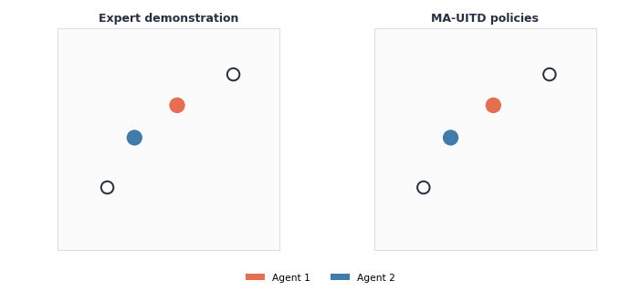
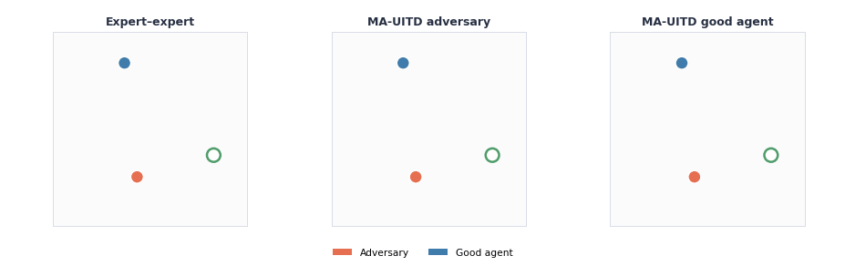
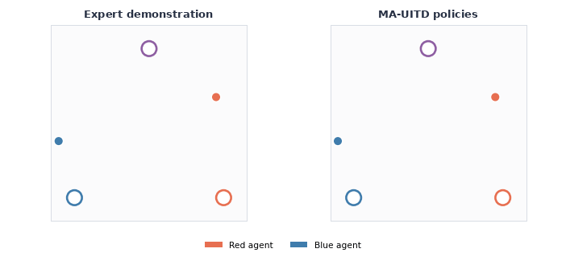
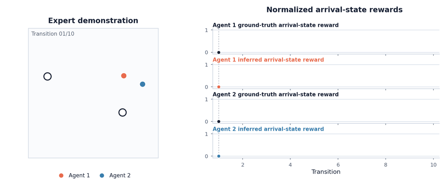
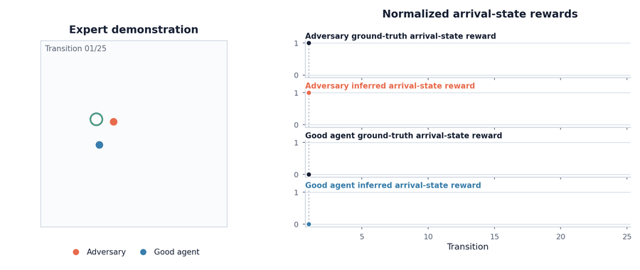
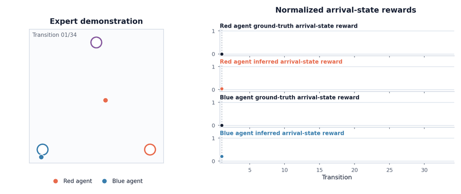

# Multi-Agent Unilateral Inverse Temporal-Difference Learning

Official code for **MA-UITD: Offline Multi-Agent Reward Inference for Characterizing Continuous Social Behavior**.

MA-UITD is an offline multi-agent inverse reinforcement learning algorithm for
discrete or bounded continuous action spaces. This repository contains the
compact implementation, the three benchmark configurations, the expert
datasets used by those configurations, and task-specific evaluation code.

## Tasks

- **Simple Spread (cooperative):** Two agents coordinate to cover two landmarks
  while avoiding collisions.
- **Simple Push (competitive):** A good agent tries to reach a target landmark
  while an adversary obstructs it through physical interaction.
- **Gems (general-sum):** Red and Blue can collect their respective private gems
  or coordinate to collect the more valuable purple gem; the episode ends when
  any gem is collected.

## Installation

The experiments were run with Python 3.10.20 and PyTorch 2.11.0 built for CUDA
12.8. The recommended installation reproduces that environment:

```bash
git clone <repository-url>
cd MA-UITD
conda env create -f environment.yml
conda activate mauitd
```

Alternatively, create a Python 3.10 virtual environment and install the pinned
requirements:

```bash
python3.10 -m venv .venv
source .venv/bin/activate
python -m pip install --upgrade pip
python -m pip install -r requirements.txt
```

The pinned `vmas==1.5.2` dependency provides the simulator used by Gems. A CUDA
12.8-capable NVIDIA driver is required for the supplied CUDA environment. To use
a different PyTorch build, install that build first and remove the pinned
`torch` line from `requirements.txt`.

## Training and evaluation

Train MA-UITD on one of the three tasks from the repository root:

```bash
python -m mauitd.train mauitd/configs/spread.yaml
python -m mauitd.train mauitd/configs/push.yaml
python -m mauitd.train mauitd/configs/gems.yaml
```

Each command loads the expert trajectories, constructs disjoint episode-level
training, validation, and test splits, alternates behavioral and inverse-TD
updates, restores the checkpoint with the lowest validation behavioral loss,
and evaluates the recovered reward and policy.

To rerun evaluation for an existing output directory without retraining:

```bash
python -m mauitd.evaluation <output-directory>
```

## Dataset interface

Additional tasks can use the common loader by storing an `.npz` file with:

```text
states          current inputs to Psi
arrival_states  arrival-state inputs to Phi
actions         per-agent demonstrated actions
episode_id
step_id
terminated
truncated
```

Set `dataset.format` to `canonical` in the task configuration. Episode IDs keep
n-step targets within trajectory boundaries.

## Policy imitation

### Simple Spread



### Simple Push



### Gems



## Reward recovery

### Simple Spread



### Simple Push



### Gems


